# Zależności ModernFormsNext 2.0.0

Strzałka prowadzi od warunku do pracy, która z niego korzysta. Pokazano
wszystkie twarde krawędzie issue i wymagane bramy. Miękkie krawędzie
są w audycie i JSON, aby wykresy pozostały czytelne.
Twardy graf ma 109 krawędzi między issue
oraz 15 bram. Sprawdzenie topologiczne nie wykryło cyklu.

## Etapy i równoległe ścieżki

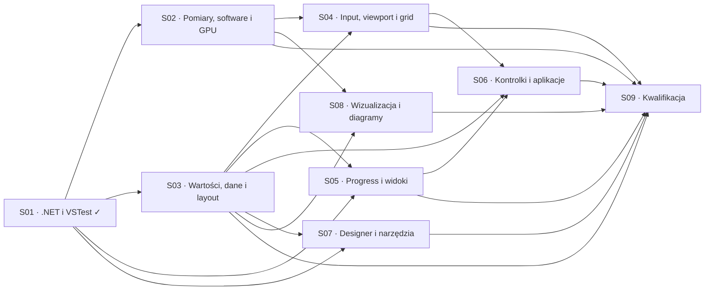

Wykres dotyczy kwalifikacji całych etapów. Niezależne PR mogą rozpocząć
się po spełnieniu warunków własnego issue i bramy.

## Ścieżki krytyczne techniczne

Ścieżki software i scroll łączą się w #454. GPU oraz Android są
odrębnymi warunkami wydania. Stan Experimental zmienia się po pełnej
macierzy i po akceptacji właściciela.

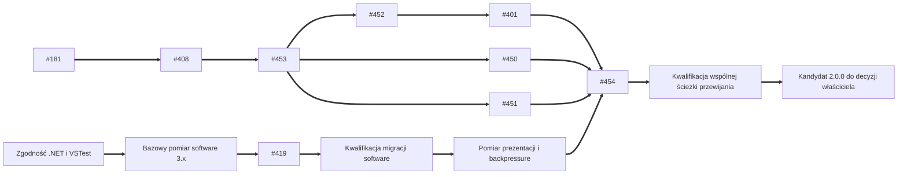

Pozostałe ważne odnogi rewalidują właściwości, progres i wykonywanie
w Designerze. Wybór pierwszych backendów GPU nastąpi po prototypach,
a pełne no-go wymaga dowodów technicznych i decyzji właściciela.

- [#194](ISSUES-AUDIT.md#issue-194) → `style-precedence` → [#177](ISSUES-AUDIT.md#issue-177) → [#178](ISSUES-AUDIT.md#issue-178).
- [#212](ISSUES-AUDIT.md#issue-212) → [#206](ISSUES-AUDIT.md#issue-206) → [#207](ISSUES-AUDIT.md#issue-207) → [#215](ISSUES-AUDIT.md#issue-215) → [#224](ISSUES-AUDIT.md#issue-224) → [#227](ISSUES-AUDIT.md#issue-227) → [#222](ISSUES-AUDIT.md#issue-222).
- [#44](ISSUES-AUDIT.md#issue-44) → `designer-support-matrix` → [#486](ISSUES-AUDIT.md#issue-486) → [#40](ISSUES-AUDIT.md#issue-40).
- `software-4x` → `gpu-prototypes` → `gpu-selection` → [#46](ISSUES-AUDIT.md#issue-46) → `gpu-qualified` → `release-qualification`.
- `software-4x` → `pacing-contract` → `gpu-selection` → [#46](ISSUES-AUDIT.md#issue-46) → `gpu-qualified` → `android-qualification` → `release-qualification`.
- [#194](ISSUES-AUDIT.md#issue-194) → [#177](ISSUES-AUDIT.md#issue-177) → [#178](ISSUES-AUDIT.md#issue-178) → [#404](ISSUES-AUDIT.md#issue-404).
- [#538](ISSUES-AUDIT.md#issue-538) → `android-qualification` → `release-qualification`.
- [#537](ISSUES-AUDIT.md#issue-537) → `android-qualification` → `release-qualification`.

## Jak rozstrzygamy pozorne cykle

- Opisy #212 i #206 wzajemnie się odsyłają. Wspólny model #212 jest
  kontraktem dla adaptera #206 i trackera #213. Model nie zależy od UI.
- #223 analizuje #215, ale ma poprzedzać jego docelowe API. #224 używa
  pojedynczej implementacji bazowego przejścia. #226 koordynuje
  parametry i własność bez wstrzymywania pierwszych prywatnych prób.
- #401, #408, #450–#453 i #449 opisują powiązane fazy. Najpierw ustalić
  fizykę i owner, później integracje i settle. #449 rozlicza dowody
  #454 i nie stawia warunku przed realizacją pozostałych prac.
- #61 i #364 mogą wymieniać deskryptory przez read-only seam, a publiczna
  edycja pozostaje osobnym rozstrzygnięciem. #403 korzysta z DevTools
  i używa istniejącego AccessibleObject.
- CSS #404 pozostaje bez milestone, ale plan obejmuje go po #194,
  #177 i #178. ControlTemplate jest osobny. #419 czeka na bazowy pomiar,
  podczas gdy pełny #114 może rozwijać się dalej.

## Usunięte cykle planowania

W roboczej kolejności było sześć cykli z udziałem miękkich zależności.
Wynikały z utożsamienia ponownego sprawdzenia lub reużycia z kolejnością
wdrożenia. Poniżej ich rozstrzygnięcie.

- [#174](ISSUES-AUDIT.md#issue-174), [#335](ISSUES-AUDIT.md#issue-335), [#336](ISSUES-AUDIT.md#issue-336). Baseline trim/AOT może powstać niezależnie. Ponowna kwalifikacja po zmianie metadanych nie blokuje rozpoczęcia #336.
- [#207](ISSUES-AUDIT.md#issue-207), [#217](ISSUES-AUDIT.md#issue-217). #207 ustanawia geometrię. #217 rozszerza ją o orientacje i markery.
- [#208](ISSUES-AUDIT.md#issue-208), [#233](ISSUES-AUDIT.md#issue-233). #208 definiuje outcome rendering. #233 mapuje nowe źródła i tokeny na ten kontrakt.
- [#229](ISSUES-AUDIT.md#issue-229), [#297](ISSUES-AUDIT.md#issue-297). Read-only historia może wyodrębnić geometrię czasu. Scrubber może ją później współdzielić.
- [#337](ISSUES-AUDIT.md#issue-337), [#419](ISSUES-AUDIT.md#issue-419). Korpus i pomiar 3.x mogą poprzedzać migrację. Porównanie 4.x staje się kryterium migracji.
- [#452](ISSUES-AUDIT.md#issue-452), [#453](ISSUES-AUDIT.md#issue-453). Kontrakt owner/cancel bazuje na scroll-to-visibility #163. Animowane API #452 korzysta z ustalonego owner.

## Bramy i przypadki częściowe

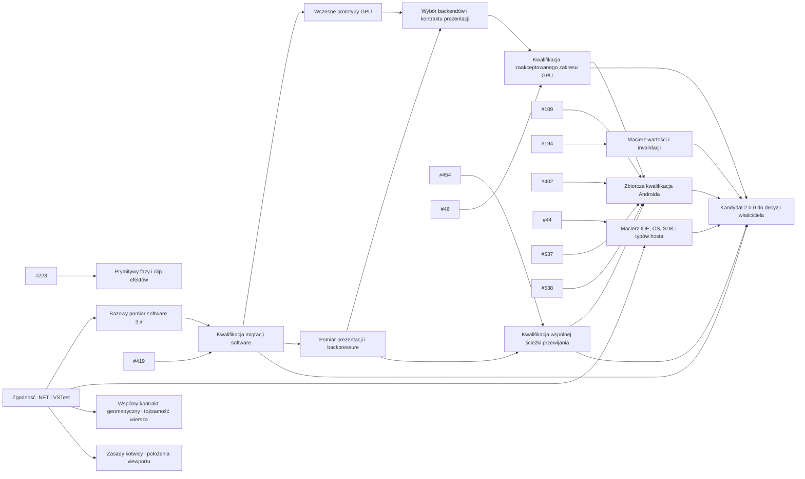

| Brama | Warunek | Dowód |
| --- | --- | --- |
| `stage1-integrated` | baza | Merged, wymagane CI i konsumenci .NET 10/11, Designer w rzeczywistym projekcie. |
| `baseline-perf` | `stage1-integrated` | Pierwszy mały PR z fixture, metadanymi i porównawczym schematem wyników. Pełny PerformanceLab rozwija się dalej. |
| `software-4x` | `baseline-perf`, [#419](ISSUES-AUDIT.md#issue-419) | Porównanie 3.x/4.x, NuGet/RID, toolchain, runtime i Designer przy niezmienionym rodzaju renderera. |
| `pacing-contract` | `software-4x` | Przyjęta metoda rozdzielenia tick, paint i present oraz decyzja UI-thread vs eksperyment. Własny render thread wymaga dowodu korzyści. |
| `style-precedence` | [#194](ISSUES-AUDIT.md#issue-194) | Udokumentowane rozstrzygnięcie efektywnej wartości i zakres repaint/layout przed rozbudową selektorów. |
| `scroll-anchor-policy` | `stage1-integrated` | Rozgraniczyć działający anchor ItemsControl od #346 i ustalić transakcję offset/extent/anchor przed dynamiczną macierzą scroll. |
| `grid-view-contract` | `stage1-integrated` | Jeden schemat indeksu i clip/frozen, mapowanie source/view i zdarzeń. Dopuszcza oddzielne implementacje filtrowania, layoutu i wyboru. |
| `progress-effects` | [#223](ISSUES-AUDIT.md#issue-223) | Potwierdzić prymityw niezależny od konkretnego renderera przed wspólnym shimmer/arc. Statyczny skeleton ma własne wejście. |
| `designer-support-matrix` | `stage1-integrated`, [#44](ISSUES-AUDIT.md#issue-44) | Jawna granica zwykłego data VSIX i kwalifikacji wykonywalnego podglądu, osobne dowody TFM i instalacji. |
| `scroll-qualified` | `pacing-contract`, [#454](ISSUES-AUDIT.md#issue-454) | Raport Windows i Android pod wersjonowanymi warunkami, deklaracja tylko zmierzonych kombinacji. |
| `release-qualification` | `software-4x`, `scroll-qualified`, `style-precedence`, `designer-support-matrix`, `gpu-qualified`, `android-qualification` | Każda przyjęta funkcja i odstępstwo ma jawną dyspozycję. Ścisłe CI i osobna zgoda na integrację finalną i publikację. Jeżeli Android pozostaje Experimental, wymagany jest raport z brakami i zaakceptowany zakres wydania. Stabilny Android wymaga pełnej macierzy. |
| `gpu-prototypes` | `software-4x` | Porównanie Windows Direct3D/ANGLE/OpenGL/Vulkan i Android GLES/Vulkan. Kryteria: dostępność, zasoby native/RID, sterownik, lifecycle, i ślad. Metal i inne platformy jako przyszłe rozszerzenie. |
| `gpu-selection` | `gpu-prototypes`, `pacing-contract` | Właściciel akceptuje zestaw backendów albo uzasadniony wyjątek. Aktualny UI-thread jest bazą. Osobny render thread jest warunkowy. |
| `gpu-qualified` | `gpu-selection`, [#46](ISSUES-AUDIT.md#issue-46) | Sprzętowe wyniki i bezpieczny software fallback, dokładna deklaracja wspieranych kombinacji. Całkowite no-go z dowodami i zgodą właściciela stanowi udokumentowany wyjątek, a nie automatyczne spełnienie. |
| `android-qualification` | `scroll-qualified`, `gpu-qualified`, [#537](ISSUES-AUDIT.md#issue-537), [#538](ISSUES-AUDIT.md#issue-538), [#109](ISSUES-AUDIT.md#issue-109), [#402](ISSUES-AUDIT.md#issue-402) | Dowody Android z urządzeń i zgodnego APK, obejmujące każdą pozycję macierzy. Zmiana Experimental wyłącznie po zatwierdzeniu zakresu i dowodów przez właściciela. Przy brakach nadal Experimental. |

Brama `progress-effects` obejmuje animowaną część #234.
Statyczny placeholder ma własny, niezależny zakres.

## Grafy obszarów

Węzły bez krawędzi mają uzasadnienie i miękkie zależności w audycie.
Numery odsyłają do [audytu](ISSUES-AUDIT.md).

### S01 · Zgodność .NET i selektywna walidacja

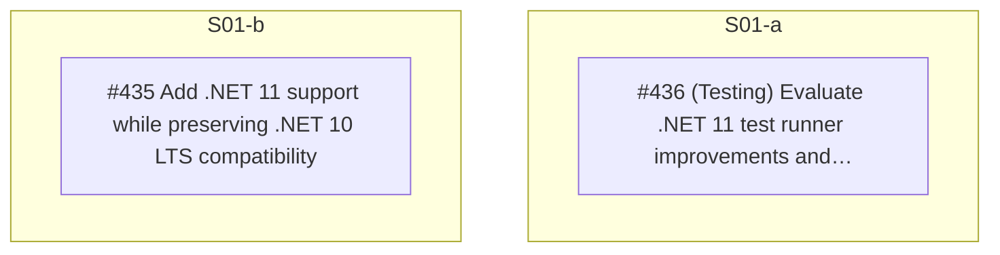

Zależności historyczne są zamknięte.

### S02 · Bazowe pomiary, migracja software i akceleracja GPU

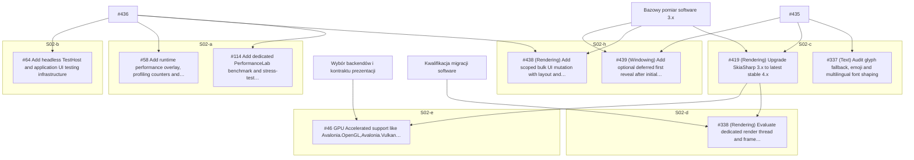

Na bazie 4.x można niezależnie badać backendy i pacing na wspólnym scenariuszu. Kontrakt UI thread, powierzchni i fallbacku integruj sekwencyjnie.

### S03 · Kontrakty wartości, danych, layoutu i platform

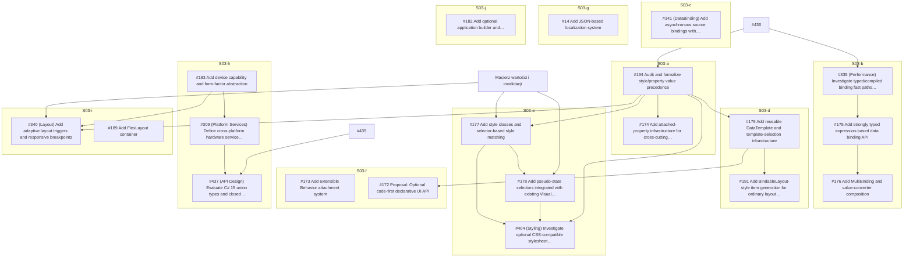

Binding, wartości, layout i device facts mają osobne strumienie. Zmieniaj kanoniczny resolver w jednym PR na raz.

### S04 · Input, przewijanie, integracje i duże dane

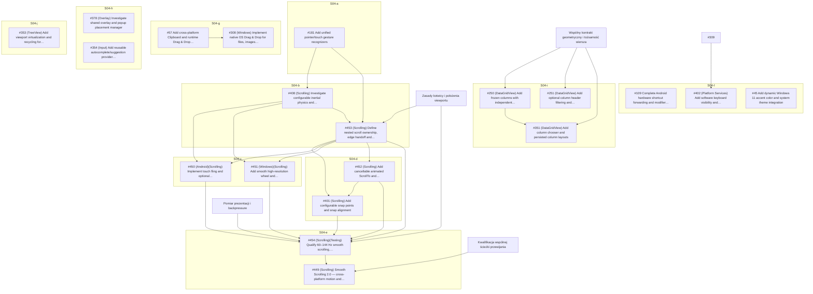

Po ustaleniu granic backendy, model gridu i popup mogą powstawać równolegle. Właściciela viewportu zmieniaj sekwencyjnie.

### S05 · Model postępu i kontrolki progresu

```mermaid
flowchart TB
  subgraph W_S05_a[S05-a]
    I212["#212 (Progress) Design shared task progress model and reporting…"]
    I213["#213 (Progress) Implement optional ProgressTracker with weighted…"]
  end
  subgraph W_S05_b[S05-b]
    I206["#206 (ProgressBar) Add segmented progress model and…"]
    I207["#207 (ProgressBar) Render weighted multicolor segments and…"]
    I208["#208 (ProgressBar) Visualize per-segment outcome statuses and…"]
  end
  subgraph W_S05_c[S05-c]
    I209["#209 (ProgressBar) Optional segment labels, status icons and…"]
    I210["#210 (Designer) Support segmented ProgressBar editing and…"]
    I211["#211 (Demo/Docs) Segmented ProgressBar examples, tests and usage…"]
  end
  subgraph W_S05_d[S05-d]
    I223["#223 (ProgressBar) Define animation architecture, preset taxonomy…"]
    I215["#215 (ProgressBar) Add smooth value transitions and customizable…"]
    I224["#224 (ProgressBar) Implement built-in value-transition animations"]
    I225["#225 (ProgressBar) Implement built-in animated fill effects"]
    I226["#226 (ProgressBar) Support developer-defined transition…"]
  end
  subgraph W_S05_e[S05-e]
    I214["#214 (ProgressBar) Add optional indeterminate per-segment rendering"]
    I216["#216 (ProgressBar) Add buffered progress display"]
    I217["#217 (ProgressBar) Support direction/orientation and threshold…"]
  end
  subgraph W_S05_f[S05-f]
    I219["#219 (Progress) Add opt-in throughput and ETA estimator"]
    I228["#228 (Progress) Add optional progress history and diagnostic sampling"]
    I229["#229 (ProgressTimeline) Add optional progress history…"]
    I231["#231 (Progress) Add opt-in forecast range visualization"]
  end
  subgraph W_S05_g[S05-g]
    I233["#233 (Progress) Bind multiple progress sources and semantic…"]
    I218["#218 (TaskProgressView) Introduce multi-task progress visualization"]
    I220["#220 (ProgressRing) Evaluate and implement circular progress…"]
  end
  subgraph W_S05_h[S05-h]
    I221["#221 (Progress) Optional segment interaction and details integration"]
    I230["#230 (Progress) Add milestone/checkpoint model and ProgressBar…"]
    I232["#232 (ProgressBar) Add responsive density and compact…"]
  end
  subgraph W_S05_i[S05-i]
    I227["#227 (Designer) Configure and preview ProgressBar animation…"]
    I222["#222 (Progress) Designer, documentation and demo coverage for…"]
  end
  subgraph W_S05_j[S05-j]
    I234["#234 Add reusable Skeleton Loading controls and loading-state…"]
  end
  G_progress_effects["Prymitywy fazy i clip efektów"]
  I206 --> I207
  I206 --> I210
  I206 --> I223
  I207 --> I208
  I207 --> I209
  I207 --> I214
  I207 --> I215
  I207 --> I217
  I207 --> I225
  I208 --> I211
  I208 --> I218
  I208 --> I233
  I209 --> I210
  I209 --> I221
  I209 --> I232
  I210 --> I211
  I210 --> I222
  I210 --> I227
  I211 --> I222
  I212 --> I206
  I212 --> I213
  I212 --> I220
  I212 --> I230
  I213 --> I218
  I213 --> I219
  I213 --> I228
  I213 --> I233
  I215 --> I224
  I215 --> I232
  I216 --> I231
  I217 --> I230
  I218 --> I222
  I219 --> I228
  I219 --> I231
  I220 --> I222
  I221 --> I222
  I223 --> I214
  I223 --> I215
  I223 --> I224
  I223 --> I225
  I223 --> I226
  I224 --> I227
  I225 --> I227
  I226 --> I227
  I227 --> I222
  I228 --> I229
  I231 --> I222
  I232 --> I222
  I233 --> I222
  G_progress_effects --> I234
```

Model i renderer mają kolejność. Tracker, historia i read-only wizualizacje mogą iść obok Designera na uzgodnionych snapshotach.

### S06 · Kompozycja aplikacji, dokumenty i kontrolki

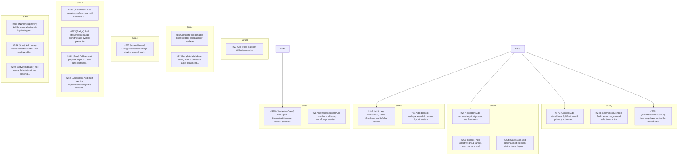

Różne rodziny, dokumenty i WebView mogą iść niezależnie. Wspólny overflow i popup powstają odpowiednio wcześniej.

### S07 · Narzędzia, dostępność i kwalifikacja kompatybilności

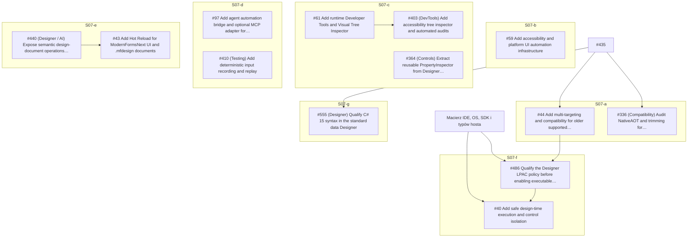

Standardowy Designer, dostępność i kompatybilność mają niezależne ścieżki. Dowody bezpieczeństwa poprzedzają włączanie wykonania.

### S08 · Wizualizacja danych i diagramy

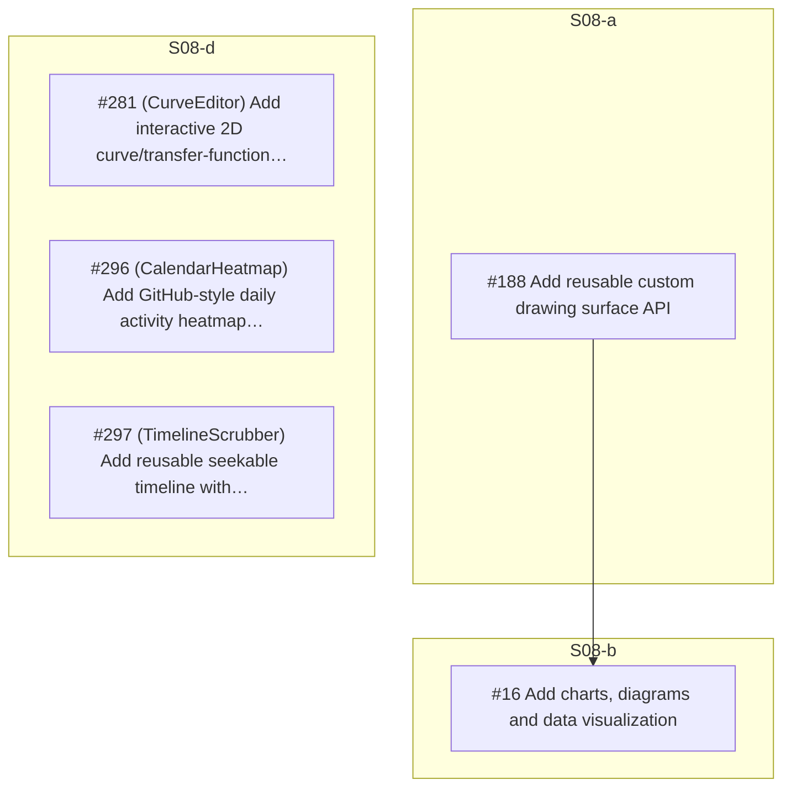

Po kontrakcie danych powstają oddzielne renderery rodzin wykresów. CPU i hardware GPU kwalifikujemy niezależnie.

### S09 · Zbiorcza kwalifikacja Androida i decyzja wydawnicza

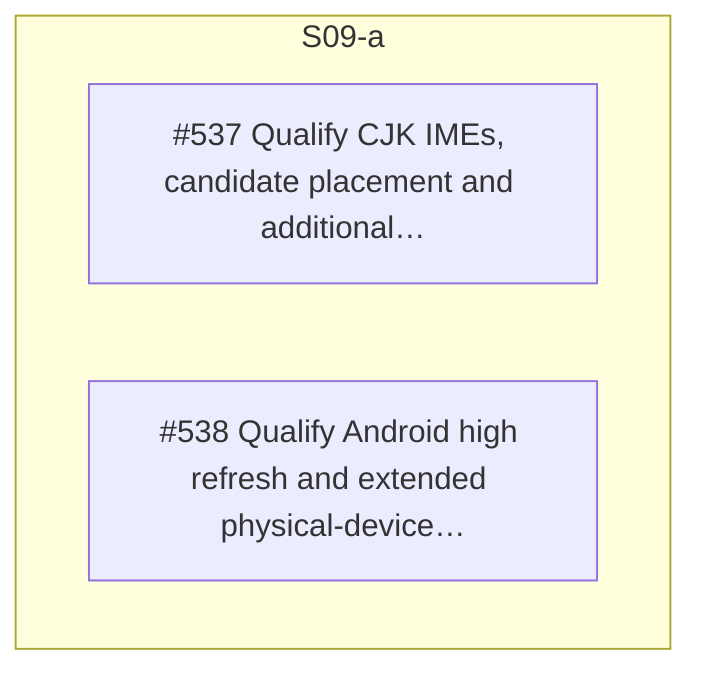

Sprzętowe stanowiska mogą pracować równolegle na jednym identyfikatorze kandydata.
